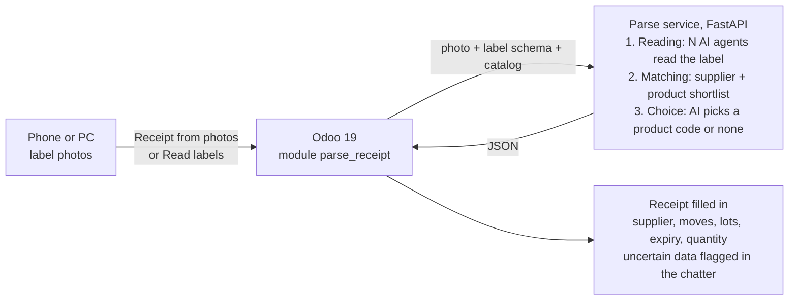

# Parse — Goods Receipt from Label Photos for Odoo 19

Fill in Odoo receipts automatically from photos of container labels.

The warehouse operator photographs the labels of the incoming containers (drums, jerrycans, jars) with a
phone. Odoo creates the receipt with supplier, products, lots, expiry dates and net quantities already
filled in. The operator only checks what the module flags and presses **Validate**.

Built for a small cosmetics manufacturer receiving raw materials, where every container carries a
supplier label with lot number and expiry date.

## How it works



**Reading** — several AI agents (Gemini) read the same photo in parallel against a JSON Schema
(`parse_receipt/schemas/label.json`). Their answers are merged field by field with an agreement score.

**Matching** — the supplier read on the label is normalised (`A.B.C. S.p.A.` → `ABC`) and matched to
the suppliers in the catalog with `rapidfuzz`; the closest products are shortlisted, the recognised
supplier's products first.

**Choice** — a second AI call sees the photo and the shortlist and must answer with one of the shortlisted
codes or `none`. The answer is constrained by a JSON Schema enum, so the AI cannot invent a product code.

## Safety first: uncertain data is never written

| Situation | What the module does |
|---|---|
| Agents disagree on a field (fewer than 2 out of 3) | the value is not written; the chatter shows the different readings |
| Expiry date in the past or more than 10 years ahead | not written, flagged |
| Product not in the catalog | no line created, flagged: the operator adds it manually |
| Label unit not convertible (litres on a product stocked in grams) | quantity left to the operator |
| Same photo uploaded twice | discarded before calling the AI (attachment checksum) |
| Several photos with the same lot | quantities added up, flagged to check the number of containers |
| Supplier on the label differs from the receipt (e.g. from a purchase order) | not overwritten, flagged |

Every warning is listed in the chatter under **⚠️ Parse: data to check before Validate** and the photo
row turns yellow in the **Parse photos** tab.

## Features

- **Receipt from photos** menu: upload photos, get one ready receipt per recognised supplier
- **Read labels** button on any receipt, including receipts created from purchase orders
- Quantities converted to the product unit (5 kg → 5000 g); month/year expiry dates set to the last day of the month
- One move per product, one detailed line per lot, expiry date written on the lot
- Works from a phone browser: upload one or more label photos at once
- Photos kept as receipt attachments for traceability
- English source, Italian translation included (`i18n/it.po`)

## Repository layout

```
parse_receipt/          Odoo 19 module
  models/               parse.receipt.photo (photo + reading status), stock.picking extension
  wizard/               upload dialog and "Receipt from photos" logic
  views/                receipt form: Read labels button, Parse photos tab
  schemas/label.json    fields the AI reads on the label
  i18n/it.po            Italian translation
parse-service/          FastAPI service called by the module
  app.py                /health, /read: reading, matching, choice
  scraper_agent.py      multi-agent extraction engine
  shared/               client resilience (retries, rate limits)
compose.yaml            Odoo + PostgreSQL + Parse for local testing
```

## Quick start

Requirements: Docker with Docker Compose, a Google Gemini API key.

```bash
git clone https://github.com/ettore-pedemonti/odoo-parse-receipt.git
cd odoo-parse-receipt
cp parse-service/.env.example parse-service/.env     # then set GEMINI_API_KEY
docker compose up -d --build
curl -s http://127.0.0.1:8001/health                 # {"status":"ok", ...}
```

Open http://localhost:8069, create a database, then in **Apps** remove the *Apps* filter, search
**Parse** and install *Parse - Goods Receipt from Label Photos*. Activate **Lots & Serial Numbers** and
**Expiration Dates** in Inventory settings. Products need an Internal Reference and, ideally, their
vendors in the Purchase tab: that is the catalog sent to Parse.

Then: **Inventory → Operations → Receipt from photos**.

## Configuration

| Setting | Where | Default |
|---|---|---|
| `GEMINI_API_KEY` | `parse-service/.env` | — (required) |
| `PARSE_MODEL` | `parse-service/.env` | `gemini-3.5-flash-lite` |
| `PARSE_N_AGENTS` | `parse-service/.env` | `3` |
| `PARSE_TIMEOUT_SEC` | `parse-service/.env` | `60` seconds per AI call |
| `parse_receipt.service_url` | Odoo system parameter | `http://parse:8000` |

## Service API

`POST /read`

```json
{
  "photo": "<base64 image>",
  "label_schema": { "...": "content of schemas/label.json" },
  "catalog": [ { "code": "MP-0001", "name": "Glycerin", "suppliers": ["ABC"] } ]
}
```

Response: `reading` (fields + agreement `<field>_%` + proposals `<field>_opts`), `supplier`,
`candidates`, `choice` (`code` or null, `confidence`, `reason`), `usage` (tokens).
Errors: `400` invalid photo, `502` AI provider error.

## Status

Working prototype, tested on Odoo 19 Community with real labels. Planned: clearer warnings for receipts
mixing several suppliers, tests, CI.

## Author and license

© Ettore Pedemonti.

Released under the GNU Lesser General Public License v3.0 (LGPL-3.0): see `COPYING.LESSER`,
which supplements the GNU General Public License v3.0 in `COPYING`. This applies to the whole
repository: the Odoo module `parse_receipt` and the `parse-service`.
